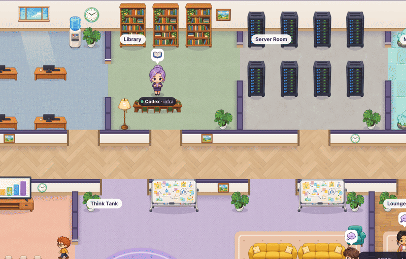
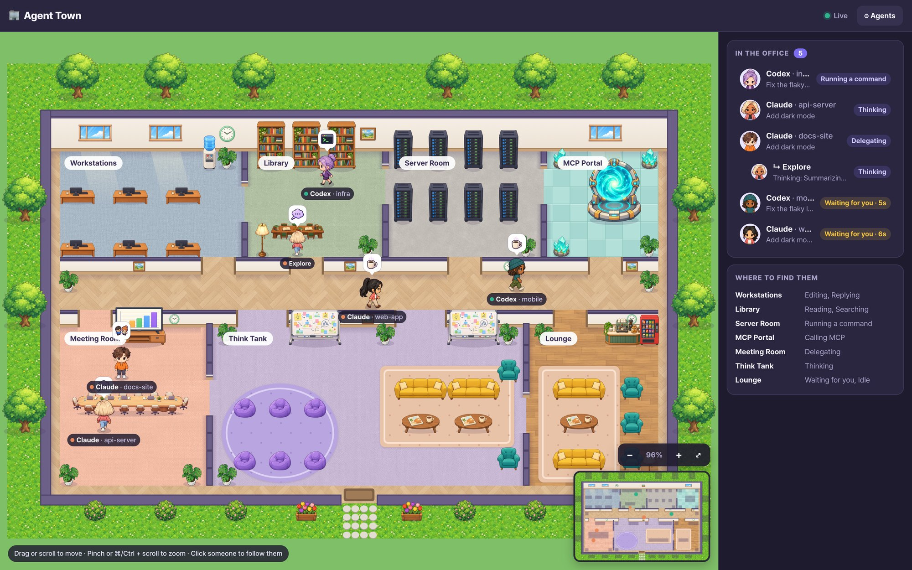
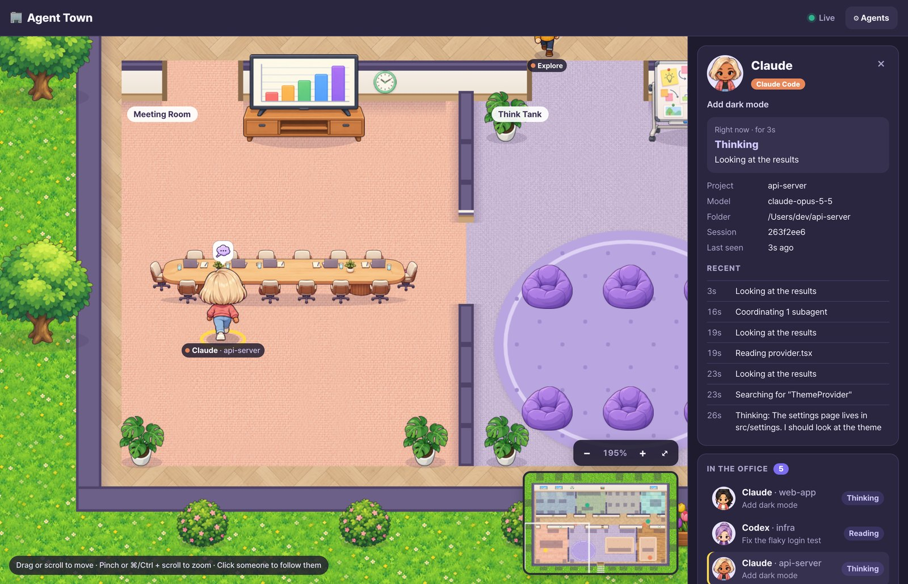

<h1 align="center">🏢 Agent Town</h1>

<p align="center">
  <b>A Gather.town / ZEP-style virtual office for your AI coding agents.</b><br>
  Watch your <b>Claude Code</b> and <b>Codex CLI</b> sessions think, read, edit and run commands,<br>
  live, as cute characters walking around a pixel office.
</p>

<p align="center">
  
</p>

<p align="center">
  
  
  
</p>

## Why

When you run several coding agents at once, it is hard to tell which one is busy,
which one is stuck, and which one is waiting for you. Agent Town turns their session
logs into an office you can glance at: every session is a character, every activity
is a room, and the ones waiting for you sit in the Lounge with a coffee.

- **Live** – follows the logs Claude Code and Codex CLI already write. No plugin, no API key, no setup in the agents.
- **One look tells you who needs you** – agents that finished their turn (or asked you a question) go to the Lounge.
- **Subagents too** – when Claude Code delegates, each subagent gets its own small character.
- **Local and lightweight** – a small Node server with zero npm dependencies, listening on `127.0.0.1` only.



## Quick start

```bash
git clone https://github.com/tobyilee/agent-town.git
cd agent-town
npm start        # open http://localhost:4321
```

Needs **Node 18 or newer**. There is nothing to install: the project has no npm dependencies.
Agent Town shows every Claude Code and Codex session that wrote to its log in the last
20 minutes, and new ones walk in as soon as they start.

No agents running right now? Try the demo, which fills the office with simulated agents:

```bash
npm run demo
```

## Using the office

| To…                         | Do this                                                         |
|-----------------------------|-----------------------------------------------------------------|
| Move around                 | Drag, scroll, or use the arrow keys / WASD                      |
| Zoom                        | Pinch, ⌘/Ctrl + scroll, the `+` `−` buttons, or the `+` `-` keys |
| See the whole office        | The `⤢` button or the `0` key                                   |
| Jump somewhere              | Click the minimap                                               |
| Follow an agent             | Click its character or its name in the roster                   |
| Stop following              | Drag the map, or press `Esc`                                    |

Click a character to open its card: what it is doing right now, the project, branch,
model, folder, its subagents and its recent history.



## Where the characters go

| Activity          | Room             | Triggered by |
|-------------------|------------------|--------------|
| Thinking          | Think Tank       | thinking blocks, reasoning, a new prompt, planning (`TodoWrite`), `ToolSearch` |
| Replying          | Workstations     | the assistant writing text, `SendMessage` |
| Editing           | Workstations     | `Edit`, `Write`, `MultiEdit`, Codex `apply_patch` |
| Reading           | Library          | `Read`, `WebFetch`, `Skill`, `cat` / `sed -n` / `head` |
| Searching         | Library          | `Grep`, `Glob`, `LSP`, `WebSearch`, `rg` / `grep` / `find` |
| Running a command | Server Room      | `Bash`, Codex shell calls |
| Calling MCP       | MCP Portal       | any `mcp__server__tool` call, Codex MCP calls |
| Delegating        | Meeting Room     | `Task` / `Agent` (each subagent gets its own character) |
| Waiting for you   | Lounge           | the turn finished, or the agent asks you something (`AskUserQuestion`, `ExitPlanMode`) |
| Idle              | Lounge (asleep)  | no reply 10 minutes after a finished turn, or no log activity for 90 seconds mid-turn |

A session leaves the office 20 minutes after its last log line.

### Designed from real agent behaviour

The floor plan and the movement rules come from replaying 500+ real Claude Code and
Codex sessions (about 128,000 events) through the parsers:

- **Thinking is the biggest share of an agent's time** (37%), and up to ~15 agents
  think at once, so the **Think Tank is the big room in the middle**.
- The most common trips are Think Tank ↔ Server Room, Library and Workstations, so
  those rooms **open onto the corridor right above it**. MCP calls and reading are rare
  and short, so their rooms are small.
- Agents switch activity every second or two (a tool call, then a look at its result),
  faster than anyone can walk across a room. So a character that is **only reviewing a
  tool result stays where it is**, and it walks somewhere new only when the new activity
  lasts 1.5 s (3 s for thinking). Its bubble still changes right away. This cuts room
  changes by 63%.

## Choosing which agents to watch

Click **⚙ Agents** in the top bar to turn each agent on or off, change its log folder,
and set your display name. Settings are saved to `~/.agent-town/config.json`
(change the location with `--config <file>` or `AGENT_TOWN_CONFIG`).

| Agent       | Default log folder |
|-------------|--------------------|
| Claude Code | `~/.claude/projects/<project>/<session>.jsonl` (subagents in `<session>/subagents/`) |
| Codex CLI   | `$CODEX_HOME/sessions/YYYY/MM/DD/rollout-*.jsonl` (default `~/.codex/sessions`) |

Other settings in the config file:

| Key                   | Default | Meaning |
|-----------------------|---------|---------|
| `port`                | `4321`  | HTTP port (also `--port <n>`) |
| `activeWindowMinutes` | `60`    | how recently a log must have changed to be read at start |
| `idleAfterSeconds`    | `90`    | mid-turn silence before an agent goes idle |
| `restAfterMinutes`    | `10`    | how long a finished agent waits for you before it falls asleep |
| `goneAfterMinutes`    | `20`    | silence before a session leaves the office |

## How it works

```
~/.claude/projects/**.jsonl ─┐                        SSE /api/events
~/.codex/sessions/**.jsonl ──┼─▶ watcher ─▶ parsers ─▶ store ──────────────▶ browser canvas
                             │   (tail)    (activity)  (agents)               (camera, sprites)
```

- `server/watcher.js` polls the log folders and tails new lines of recently changed files.
  Polling, rather than `fs.watch`, behaves the same on macOS, Linux and WSL.
- `server/parsers/claude.js` and `server/parsers/codex.js` turn each log line into an activity;
  `server/activity.js` classifies tools and shell commands.
- `server/store.js` keeps one agent per session (plus one per running subagent) and streams
  snapshots to the browser over server-sent events.
- `client/office.js` draws the office through a camera (pan, zoom, follow), gives each agent
  a spot in the room for its activity, and walks it there along a grid path.
  `client/office-map.js` is the floor plan (rooms, walls, doors, spots, furniture), and
  `client/floor.js` paints the floors and walls once.

## Art

All characters, furniture, floor textures and status icons were drawn with
**Codex headless image generation** (`codex exec` with the `image_generation` feature) and
fitted to a fixed sprite grid. The prompts live in [`sprites/assets.json`](sprites/assets.json),
and the format is described in [`sprites/SPEC.md`](sprites/SPEC.md).

```bash
npm run sprites:codex                 # draw every image missing from sprites/raw/, then fit them
npm run sprites:codex -- desk char_3  # redraw just these
npm run sprites:codex -- --all        # redraw everything
npm run sprites:fit                   # only refit the raw images already there
npm run sprites:check                 # verify every file has the size the client expects
```

Redrawing needs the Codex CLI signed in and `python3` (Pillow and numpy are installed into
`sprites/.venv` on first run). `CODEX_WORKERS` sets how many Codex runs work in parallel
(default 6), and `CODEX_FLAGS` passes extra flags to `codex exec`. Running the app needs
none of this.

Text uses [Pretendard](https://github.com/orioncactus/pretendard) by Kil Hyung-jin, bundled
under the SIL Open Font License ([`client/assets/fonts/LICENSE-Pretendard.txt`](client/assets/fonts/LICENSE-Pretendard.txt)).

## Privacy

Agent Town reads your agents' session logs on your own machine and serves the office to
your browser from `127.0.0.1`. It makes no network requests of its own and sends no telemetry.

Other websites you visit cannot get at it either: the server only answers requests
addressed to `localhost` (which stops DNS-rebinding pages from reading your agents'
activity), and it only accepts settings changes sent as JSON from its own page (which stops
cross-site requests). There is no login, so keep the port on your machine: do not forward
or expose it to a network you do not trust.

## Development

```bash
npm test     # parser, store, restart and floor-plan tests (node:test)
npm run demo # simulated agents, handy when working on the office
```

The floor-plan tests check that every spot is free, inside its room and reachable from the
front door, so you can move furniture around in `client/office-map.js` with confidence.

## Roadmap: a shared office

Agents already carry a `userId` and `userName`, and the office is drawn from a plain
snapshot. The next step is a small relay that merges the snapshots of several developers'
Agent Town servers into one shared office, with each person's name on their agents' tags.

## License

[MIT](LICENSE) © 2026 Toby Lee. The bundled Pretendard font is licensed under the
SIL Open Font License 1.1.
