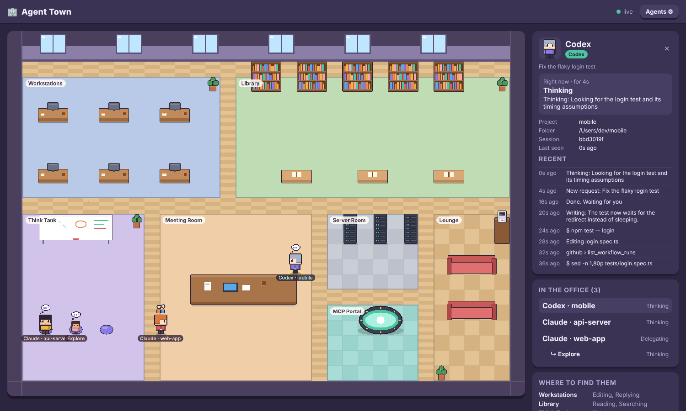

# Agent Town 🏢

A Gather.town-style pixel office where your AI coding agents work as cute animated
characters. Agent Town tails the session logs that **Claude Code** and **Codex CLI**
write on your machine and shows, live, what each agent is doing: thinking, reading or
editing files, searching, running commands, calling MCP tools, or delegating to
subagents. Click a character to see its current task and recent history.



## Quick start

```bash
npm start          # http://localhost:4321, watches your real Claude Code and Codex logs
npm run demo       # same office, filled with simulated agents
```

Needs Node 18 or newer. There are no npm dependencies to install.

## What the characters do

| Activity          | Where they go  | Triggered by                                                 |
|-------------------|----------------|--------------------------------------------------------------|
| Thinking          | Think Tank     | thinking blocks, reasoning, a new prompt, reading results    |
| Replying          | Workstations   | the assistant writing text                                   |
| Editing           | Workstations   | `Edit`, `Write`, `MultiEdit`, Codex `apply_patch`            |
| Reading           | Library        | `Read`, `WebFetch`, `cat`/`sed -n`/`head` commands           |
| Searching         | Library        | `Grep`, `Glob`, `WebSearch`, `rg`/`grep`/`find` commands     |
| Running a command | Server Room    | `Bash` and Codex shell calls                                 |
| Calling MCP       | MCP Portal     | any `mcp__server__tool` call, Codex `mcp_tool_call_begin`    |
| Delegating        | Meeting Room   | `Task`/`Agent`; each subagent gets its own small character   |
| Waiting for you   | Lounge         | the turn ended                                               |
| Idle              | Lounge (asleep)| no log activity for 90 seconds                               |

Sessions that have been quiet for 30 minutes leave the office.

## Choosing which agents to watch

Click **Agents ⚙** in the top bar to turn each agent on or off, change its log folder, and
set your display name. Settings are saved to `~/.agent-town/config.json`
(override with `--config <file>` or `AGENT_TOWN_CONFIG`).

| Agent       | Default log folder                                   |
|-------------|------------------------------------------------------|
| Claude Code | `~/.claude/projects/<project>/<session>.jsonl` (subagents in `<session>/subagents/`) |
| Codex CLI   | `$CODEX_HOME/sessions/YYYY/MM/DD/rollout-*.jsonl` (default `~/.codex/sessions`) |

Other options in the config file: `port`, `activeWindowMinutes` (how old a log can be
and still be picked up at start), `idleAfterSeconds`, `goneAfterMinutes`.

## Sprites

The art in `client/assets/sprites/` follows [`sprites/SPEC.md`](sprites/SPEC.md).

- `npm run sprites` regenerates the built-in placeholder pixel art (pure Node, no dependencies).
- `npm run sprites:codex` asks **Codex headless** (`codex exec`) to generate characters,
  status icons and the office with its image generation tool, then fit them to the spec.
  Pass a group to redo just one part: `npm run sprites:codex -- characters|fx|office`.
  Extra `codex exec` flags go in `CODEX_FLAGS`.
- `npm run sprites:check` verifies every file has the exact size the client expects.

## How it works

```
~/.claude/projects/**.jsonl ─┐                       SSE /api/events
~/.codex/sessions/**.jsonl ──┼─▶ watcher ─▶ parsers ─▶ store ─────────────▶ browser canvas
                             │   (tail)    (activity)  (agents)              (office, sprites)
```

- `server/watcher.js` polls the log folders, tails new lines of recently modified files.
- `server/parsers/claude.js` and `server/parsers/codex.js` turn each line into an activity.
- `server/store.js` keeps one agent per session (plus one per running subagent) and
  streams snapshots to the browser over server-sent events.
- `client/office.js` draws the office, assigns each agent a spot in the zone for its
  activity, and walks it there along a grid path. `client/office-map.js` is the layout,
  shared with the placeholder sprite generator.

The server only listens on `127.0.0.1`. Log contents never leave your machine.

## Roadmap: shared office

Agents already carry a `userId`/`userName`, and the office is rendered from a plain
snapshot, so the next step is a small relay that merges snapshots from several
developers' Agent Town servers into one shared office (each person's agents with
their name on the tag).

## Development

```bash
npm test    # parser and store tests (node:test)
```
